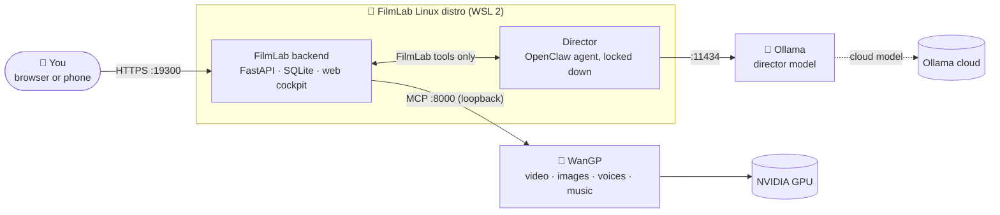

<div align="center">

# 🎬 FilmLab Studio

**An AI film studio that runs on your own PC.**
Describe a film. An AI director plans the scenes, shots, dialogue and sound. [WanGP](https://github.com/deepbeepmeep/Wan2GP) renders them on your GPU.
You review, edit and export the finished film, from your desk or your phone.

[](#-requirements)
[](#-requirements)
[](#-architecture)
[](#-architecture)
[](https://github.com/deepbeepmeep/Wan2GP)
[](LICENSE)

[Quick start](#-quick-start) · [Features](#-features) · [How it works](#-how-it-works) · [Documentation](#-documentation) · [FAQ](#-faq)

</div>

---

## ✨ Features

<table>
<tr>
<td width="50%" valign="top">

### 🎭 An AI director that plans your film
- Write a **brief** in your own words; the director turns it into **scenes and shots** with prompts, references, lengths, transitions and a reason for each.
- Long films are planned **scene by scene** so nothing gets lost.
- Chat with it to rework a shot, and watch **every step it takes** live.
- **Enhance** turns a rough idea into a full shot prompt built around your library references.

</td>
<td width="50%" valign="top">

### 🗣️ Exact dialogue and sound
- Each shot has a **Sound** section: who says which **exact words**, how they say it, the sounds of the place, and music.
- FilmLab writes it into the video model's own script format, so lines are spoken **as written** and silent shots stay silent.
- Give a character a **voice sample** and they keep the same voice in every shot.

</td>
</tr>
<tr>
<td valign="top">

### 📚 A reference library with a Creator
- Characters, locations, props, styles and sounds, with versioned **looks** so a character stays consistent.
- **✨ Create with the director**: describe a character, place or prop; the director drafts it, WanGP generates an anchor image and matching views (and a voice, or music), and you approve it into the library.

</td>
<td valign="top">

### 🎞️ Storyboard, review and edit
- A **film strip** of the whole film at a glance; drag to reorder.
- Render one shot or the **whole storyboard as a batch**, with live progress and **time estimates**.
- Mark takes 👍 / 🤔 / 👎, compare A/B, and **reshoot** with one click.
- Trim, add **20+ transitions**, music, titles and captions, then **export** an MP4 (H.264/AAC) with SRT captions.

</td>
</tr>
<tr>
<td valign="top">

### 🛡️ You stay in control
- Nothing renders without your approval. Autonomy levels from **A0 (plan only)** to **A3 (bounded redo runs within your limits)**.
- The director is **locked down**: no shell, files, web or other agents. It can only use FilmLab's own tools.
- **Hold GPU work** pauses FilmLab whenever you need the GPU for something else.

</td>
<td valign="top">

### 🏠 Local, private, phone-friendly
- Runs on **your PC**: your films, references and voices never leave it. (The director model runs in Ollama's cloud; see [Security](docs/security.md).)
- A responsive **web cockpit** that works on your phone over your home network (HTTPS with a private certificate).
- Daily **backups**, verification and one-command restore.

</td>
</tr>
</table>

## 🧭 How it works



1. **You write a brief.** The **director** (an [OpenClaw](https://www.npmjs.com/package/openclaw) agent running a model through [Ollama](https://ollama.com)) plans it using only FilmLab's tools.
2. **You approve shots.** FilmLab sends them to **WanGP** through its MCP server, one at a time on your GPU, with your library images and voices as references.
3. **You review and edit.** Keep the best takes, reshoot the rest, assemble the edit and export the film.

FilmLab never downloads models on its own and never touches WanGP's other jobs. WanGP stays yours: FilmLab works in its own WanGP workspace.

## 💻 Requirements

| | Minimum | Recommended |
|---|---|---|
| **OS** | Windows 11 22H2 (build 22621) | Windows 11 24H2 or newer |
| **GPU** | NVIDIA RTX, 12 GB VRAM | NVIDIA RTX, **16 GB+ VRAM** (e.g. RTX 4080 / 4090 / 5080 / 5090) |
| **Memory** | 32 GB | 64 GB |
| **Disk** | 100 GB free | 150 GB+ free (models alone take 50–100 GB) |
| **Network** | Internet for setup, models and the director | Home Wi-Fi/LAN if you want to use your phone |
| **Accounts** | A free [Ollama](https://ollama.com) account (for the cloud director model) | |

The setup assistant checks all of this for you before it changes anything.

## 🚀 Quick start

> [!IMPORTANT]
> FilmLab Studio is a Windows 11 application that uses **WSL 2**, **Ollama** and **WanGP**. The setup assistant finds what you already have, tells you how to get what's missing, and installs the rest.

**1. Get FilmLab** into the folder where it should live, e.g. `C:\FilmLab` (not Downloads or OneDrive: the folder stays in use).

- **Nothing installed yet?** Click **Code → Download ZIP** above, and extract it to `C:\FilmLab`. Setup connects it to GitHub for updates later.
- **Have Git?**
  ```powershell
  git clone https://github.com/merberg-ai/wan2gp-filmlab-studio.git C:\FilmLab
  ```

**2. Run the setup assistant:** double-click **`Setup-FilmLab.cmd`** in that folder. If Windows says *"Windows protected your PC"*, click **More info → Run anyway**: the script isn't signed, but it's this repository's own.

It walks you through ten steps and asks before every change:

| Step | What happens |
|---|---|
| 1. This PC | Checks Windows, GPU and VRAM, memory and disk space |
| 2. WSL | If WSL 2 is missing, shows you how to install it and waits; turns on mirrored networking (with your OK) |
| 3. Ollama | If Ollama is missing, tells you where to get it and waits; you sign in, then it pulls the director model |
| 4. WanGP | Finds your WanGP (including Pinokio installs) or clones it and runs **WanGP's own installer**; turns on its MCP server and starts it |
| 5. FilmLab | Creates the FilmLab Linux distro and installs the director, the backend and the cockpit |
| 6. Your login | You choose the cockpit username and password |
| 7. Start | Starts FilmLab |
| 8. Models | Lists the WanGP models FilmLab uses and offers to download the missing ones now |
| 9. Phone access | *Optional:* HTTPS access from your phone and other devices on your home network |
| 10. Autostart | *Optional:* start FilmLab when you log on |
| 11. Updates | If you downloaded the ZIP, connects the folder to GitHub so you can update later |

While it waits for something you're installing (WSL, Ollama, Git), it checks again by itself every few seconds: just follow the instructions on screen.

**3. Open the cockpit** at **http://127.0.0.1:19300** (or the HTTPS address setup shows you) and sign in.

> [!TIP]
> Run `Setup-FilmLab.cmd` again any time: every step checks first, so it continues where it stopped or repairs what's missing.
> To only see what's installed, run `scripts\install\Setup-FilmLab.ps1 -CheckOnly`.

See the **[Installation guide](docs/installation.md)** for every step in detail, manual installation and uninstalling.

## 🎥 Make your first film

1. **Projects → New project.** Pick a template (horror teaser, music video, illustrated story, character dialogue) or start blank.
2. **Build your cast** in the **Library**: upload reference images, or use **✨ Create with the director** to generate a character, location or prop (and a character's voice).
3. **Write the brief** in the project and press **Plan with director**. Scenes and shots appear in the storyboard, each with its Sound.
4. **Review the plan.** Edit any shot, set its dialogue, or press **✨ Enhance**.
5. **Render storyboard…** to render everything as a batch, or **Approve & render** shot by shot.
6. **Review takes.** 👍 keep, 👎 reject and reshoot, or ask the director to fix a shot.
7. **Edit & export.** Trim, add transitions, music, titles and captions, then export your MP4.

The **[User guide](docs/user-guide.md)** covers every screen.

## 📖 Documentation

| Guide | What's in it |
|---|---|
| 📦 [Installation](docs/installation.md) | The setup assistant step by step, manual install, updating, uninstalling |
| ▶️ [Running FilmLab](docs/running.md) | Starting and stopping, phone access, backups, updates, health checks |
| 🎬 [User guide](docs/user-guide.md) | Projects, the director, storyboard, sound and voices, library and Creator, review, edit and export |
| 🩺 [Troubleshooting](docs/troubleshooting.md) | Common problems and how to fix them |
| 🛡️ [Security](docs/security.md) | What runs where, what the director can and can't do, network exposure |

## 🏗️ Architecture

| Component | Technology | Runs in |
|---|---|---|
| Backend and API | Python 3.12, FastAPI, SQLite (WAL), uvicorn | FilmLab WSL distro |
| Web cockpit | React, TypeScript, Vite | Served by the backend |
| Director | OpenClaw agent (locked-down tool policy) | FilmLab WSL distro, loopback only |
| Director model | `gemma4:31b-cloud` via Ollama (configurable) | Ollama on Windows (cloud model) |
| Rendering | WanGP over MCP (MiniMax H3, LTX-2, Z Image, Flux Klein, Qwen3 TTS, ACE-Step…) | WanGP on Windows, your GPU |
| Media | ffmpeg (inspection, thumbnails, export, loudness) | FilmLab WSL distro |

<details>
<summary><b>Repository layout</b></summary>

```text
backend/            FastAPI app, director tools, renders, library, edit and export, tests
frontend/           React cockpit
agent/workspace/    The director's instructions (installed into OpenClaw)
scripts/            filmlabctl (start/stop/status/logs), update, rollback, restore
scripts/install/    Setup-FilmLab.ps1 and the distro, director, TLS and firewall scripts
docs/               Documentation
Setup-FilmLab.cmd   The setup assistant (double-click)
```

</details>

## ❓ FAQ

<details>
<summary><b>Does it need the internet?</b></summary>

For setup, for downloading models, and for the director: the default director model (`gemma4:31b-cloud`) runs in Ollama's cloud. Rendering, review, editing and export run entirely on your PC. You can point the director at a local Ollama model instead (**Settings → Director**), at the cost of GPU memory while it runs.
</details>

<details>
<summary><b>Can I keep using WanGP myself?</b></summary>

Yes. FilmLab works in its own WanGP workspace, never cancels or changes your WanGP jobs, and waits in WanGP's queue behind them. Use **Hold GPU work** when you want the GPU to yourself.
</details>

<details>
<summary><b>Which models does it use?</b></summary>

By default: MiniMax H3 Ref2VA / FL2VA (video with sound), Z Image Turbo and Flux Klein 9B (reference images), Qwen3 1.7B voice design (character voices) and ACE-Step 1.5 (music). You can choose any installed WanGP template in **Settings**. FilmLab only offers what is installed and usable.
</details>

<details>
<summary><b>How long does a shot take?</b></summary>

On an RTX 4080 SUPER, a 5-second 832×480 shot takes about 2½ minutes; a 5-second 1280×720 shot about 4½ minutes. A 30-second film is roughly 15–30 minutes of GPU time per pass.
</details>

<details>
<summary><b>Does it work on Linux, macOS or AMD GPUs?</b></summary>

Not yet. FilmLab Studio targets Windows 11 with WSL 2 and an NVIDIA GPU. WanGP itself supports more platforms, so this may come later.
</details>

## 🙏 Acknowledgements

FilmLab Studio stands on the shoulders of:

- **[WanGP / Wan2GP](https://github.com/deepbeepmeep/Wan2GP)** by DeepBeepMeep: the renderer and its MCP server.
- **[OpenClaw](https://www.npmjs.com/package/openclaw)**: the agent runtime behind the director.
- **[Ollama](https://ollama.com)**: the director's model runtime.
- The model authors whose work WanGP runs (MiniMax, Lightricks, Black Forest Labs, Alibaba Qwen, ACE-Step and others); each model keeps its own license.

## 📄 License

FilmLab Studio is released into the public domain under the [Unlicense](LICENSE).
WanGP, OpenClaw, Ollama and the models are separate projects with their own licenses; FilmLab doesn't include them.
